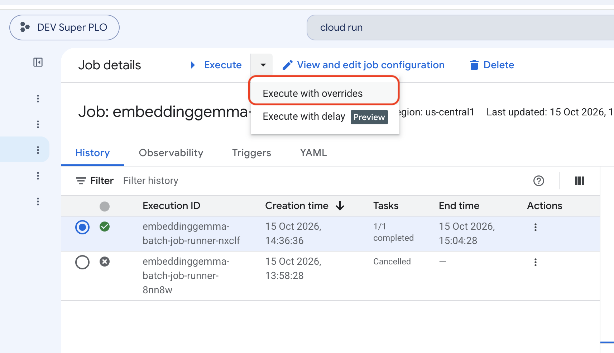
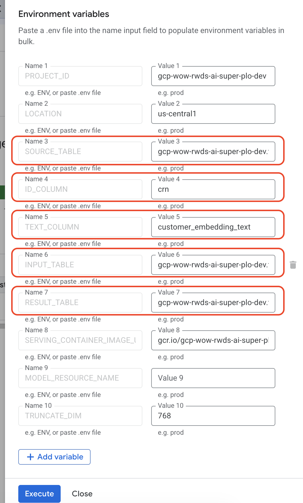

# Legacy EmbeddingGemma workflow

This copied text-only workflow is preserved during migration. Run all commands
below from `pipeline/legacy/`. The batch runner and shared workflow retain
their existing behavior; their relative paths remain unchanged.

The predictor has moved to
[`batch_text_embedding/`](../../batch_text_embedding/README.md). The legacy
`make build` and `make push` targets forward to its new build directory.
Cloud Run deployment/execution and batch-runner build targets stay here.
The copied `vertex_pipeline/` is a text-only reference, not the future full
two-tower pipeline. See [`../README.md`](../README.md) for that boundary.

The remaining documentation describes the copied workflow, including its
older partial-result behavior. Do not treat it as the target pipeline
contract.

This project runs a BigQuery-to-BigQuery embedding workflow with
`google/embeddinggemma-300m`. It uses a custom Vertex AI prediction container
for GPU inference and a separate batch job runner for orchestration.

## How to run the pipeline

### Recommended: run the Cloud Run job

The main customer-test entry point is:

```bash
make run-customer-test-cloud-run
```

This target deploys the existing batch job image, applies the configured
customer-test tables and columns, and executes the Cloud Run Job. The default
task timeout is 20 hours; override it when necessary:

```bash
CLOUD_RUN_TASK_TIMEOUT=12h make run-customer-test-cloud-run
```

Cloud Run task retries are disabled (`--max-retries=0`) to prevent a failed
runner attempt from automatically submitting another Vertex AI batch job.
A failed execution requires manual recovery. Vertex's internal request retries
are unaffected. This does not prevent duplicate manual or scheduled executions,
and stopping the runner does not cancel an already submitted Vertex job.

Before running it, authenticate with Google Cloud and make sure the caller and
the Cloud Run runtime service account can access the configured BigQuery
tables, Vertex AI, the serving image, and the pre-configured model artifacts:

```bash
gcloud auth application-default login
gcloud config set project gcp-wow-rwds-ai-super-plo-dev
```

The customer-test Makefile parameters are:

| Parameter | Default | Description |
| --- | --- | --- |
| `CUSTOMER_TEST_SOURCE_TABLE` | `gcp-wow-rwds-ai-super-plo-dev.two_tower.super_long_term_customer_text_small` | Fully qualified BigQuery table containing the source records to embed. |
| `CUSTOMER_TEST_TEXT_COLUMN` | `customer_embedding_text` | Column containing the text that is sent to the embedding model. |
| `CUSTOMER_TEST_INPUT_TABLE` | `gcp-wow-rwds-ai-super-plo-dev.two_tower.customer_embedding_input_test` | Fully qualified BigQuery table created or replaced with the serialized Vertex AI batch-prediction input instances. |
| `CUSTOMER_TEST_RESULT_TABLE` | `gcp-wow-rwds-ai-super-plo-dev.two_tower.super_long_term_customer_text_small_d768` | Fully qualified BigQuery table receiving every original source column and row, plus an `embedding` array. |

`INPUT_TABLE` is a temporary staging table for Vertex AI batch prediction. It
contains one JSON instance, `{"text": "..."}`, per distinct model-input string
from `TEXT_COLUMN`. Null text becomes an empty string for inference only.
Empty strings and whitespace-only strings are embedded, not excluded; no other
trimming, case folding, or text normalization is applied.

Predictions are joined back by that same text expression. `RESULT_TABLE`
preserves every original row and column, including duplicate rows and null
values, and appends `embedding` as `ARRAY<FLOAT64>`. Null and empty-string text
share the empty-string embedding; their original text values stay unchanged.
No ID column is required, and `ID_COLUMN` / `CUSTOMER_TEST_ID_COLUMN` have been
removed.

Before replacing the result table, the workflow rejects duplicate, unexpected,
or invalid predictions and checks that the row count is preserved. If Vertex
reports success but some texts have no prediction, the result is still
published: affected rows have `embedding = []`. The Cloud Run runner logs a
warning with the missing distinct-text count and affected source-row count.
Failed, cancelled, or expired Vertex jobs still stop before postprocessing.
An entirely empty source skips
inference and produces an empty result table with the embedding column.
`input_rows` now counts distinct model inputs, while `result_rows` counts all
source rows.

Keep the source table unchanged until the job finishes, and use separate
staging/result table names for overlapping runs. Use a source snapshot if
writers cannot be paused. The source should not already contain an `embedding`
column; write results to a separate table.

To run against different tables or columns:

```bash
make run-customer-test-cloud-run \
  CUSTOMER_TEST_SOURCE_TABLE=gcp-wow-rwds-ai-super-plo-dev.two_tower.super_long_term_customer_text_small \
  CUSTOMER_TEST_TEXT_COLUMN=description \
  CUSTOMER_TEST_INPUT_TABLE=gcp-wow-rwds-ai-super-plo-dev.two_tower.customer_embedding_input \
  CUSTOMER_TEST_RESULT_TABLE=gcp-wow-rwds-ai-super-plo-dev.two_tower.super_long_term_customer_text_small_d768
```

### Run from the Cloud Run web console

Open the [EmbeddingGemma batch job in the Cloud Run
console](https://console.cloud.google.com/run/jobs/details/us-central1/embeddinggemma-batch-job-runner/executions?project=gcp-wow-rwds-ai-super-plo-dev)

to start and monitor the job:

1. Open **Cloud Run > Jobs** and select `embeddinggemma-batch-job-runner`. (Or open the linked above)
2. Click **Execute** or **Execute with overrides**.
3. In **Container(s) > Variables & secrets**, set the runtime variables:
   `SOURCE_TABLE`, `TEXT_COLUMN`, `INPUT_TABLE`, and
   `RESULT_TABLE`.
4. Click **Execute** and monitor the execution in the job details page.





In the web console, use the runtime variable names rather than the
`CUSTOMER_TEST_*` Makefile names. The overrides apply only to that execution
and do not change the saved job configuration. The runtime service account
must have access to all specified BigQuery resources. Executing with overrides
requires the **Cloud Run Developer** role on the job; see the
[Cloud Run job execution documentation](https://cloud.google.com/run/docs/execute/jobs).

### Run locally

For local execution, use:

```bash
python3 -m pip install -r batch_job_runner/requirements.txt
make run-customer-test
```

The runner prepares the BigQuery input table, submits and waits for the Vertex
AI batch prediction, then writes the final output to
`CUSTOMER_TEST_RESULT_TABLE`.

## Configuration

The default configuration targets project
`gcp-wow-rwds-ai-super-plo-dev`, Vertex AI location `us-central1`, and the
following pre-configured resources:

- Serving image:
  `gcr.io/gcp-wow-rwds-ai-super-plo-dev/text-embedding-batch-prediction`
- Cloud Run Job:
  `embeddinggemma-batch-job-runner`
- Output dataset:
  `gcp-wow-rwds-ai-super-plo-dev.two_tower`

Common overrides include `PROJECT_ID`, `LOCATION`, `SOURCE_TABLE`, `TEXT_COLUMN`,
`INPUT_TABLE`, `OUTPUT_DATASET`, `RESULT_TABLE`, `MODEL_RESOURCE_NAME`,
`MODEL_ARTIFACT_URI`, and `SERVING_CONTAINER_IMAGE_URI`.

## Container builds (already done)

Rebuild and publish the batch job runner image to deploy changes to the shared
workflow, then deploy the updated Cloud Run job. The distinct-text change does
not require rebuilding the prediction image. The existing build targets are:

```bash
# Vertex AI prediction image
make build
make push

# Cloud Run batch job image
make build-batch-job-runner
make push-batch-job-runner
```

## Passing `truncate_dim`

For online prediction requests, pass `truncate_dim` under the `parameters`
object:

```json
{
  "instances": [
    { "text": "Product description text..." }
  ],
  "parameters": {
    "truncate_dim": 256
  }
}
```

For BigQuery batch prediction, Vertex AI sends only the `instances` payload.
Set `TRUNCATE_DIM` when running the batch job runner to configure the model
during registration:

```bash
TRUNCATE_DIM=256 \
  PYTHONPATH=shared python3 batch_job_runner/run_batch_prediction.py
```

Changing `TRUNCATE_DIM` for an existing `MODEL_RESOURCE_NAME` requires
registering a new model because model environment variables are fixed at
upload time.
